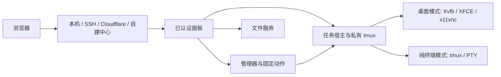

# 架构与安全边界

每套部署面向一位管理员，运行在自己的 Linux 用户和工作区。客户端使用浏览器，访问入口与工作区模式独立组合，见[部署选择](deployment.md)。

## 组件

面板、helper 监听回环，公网 Tunnel 使用私有 Unix 接口；VNC 不开启公共 TCP 监听。桌面模式有独立显示、Xauthority、D-Bus、XFCE 设置与 tmux socket，和物理桌面分开。**Linux 用户与文件系统没有沙箱隔离**，工作台拥有部署用户本身的权限。

## 生命周期

宿主持有任务，面板和浏览器持有观看／输入连接。关闭浏览器、切换网络或重载 panel 不主动结束任务。明确结束终端或重启宿主会影响相应程序；恢复连接不自动启动 Codex、重发输入或审批。[服务关系](reliability.md)

桌面部署包括 desktop、actions、files、manager、panel；纯终端包括 terminal、files、manager、panel。cloudflared 和自建 frpc 是可选入口组件，不是任务宿主。中心服务器与节点使用不同的服务及权限，详见[中心部署](selfhost-server.md)和[服务生命周期](reliability.md)。

## 认证与权限

HTTP 与 WebSocket 保留登录、Host、Origin 和 CSRF 检查。Cookie 为 HttpOnly、SameSite=Strict，HTTPS 下使用 Secure；服务端持久化会话哈希，不向 VNC 或浏览器返回内部密钥。

控制权绑定登录、页面与观看代次，接管使旧页面停止输入。屏幕锁和临时账号在服务端限制终端、画面、剪贴板、文件及映射权限，具体见[访问权限](access.md)。

内部 helper 只接受固定动作，不把浏览器输入插入 shell 命令。文本粘贴与 Enter 分开，执行回复未知时不自动重试。

## 网络路径

HTTPS／WSS 提供登录、控制和中转；网络条件允许时，WebRTC 使用可靠、有序 DataChannel，配合认证协商与 DTLS。直连失败可回退，输入不能被两条路径重复执行。候选与 UDP 范围见[网络说明](lan.md)，协议及背压限制见[开发参考](network-protocol.md)。自建中心可向在线节点签发短期 TURN 凭据，仅放行指定公网 IPv4 与 relay 端口范围；普通 Cloudflare 模式没有通用 TURN 配置入口。

固定网关增加 Worker 与独立 SQLite DO：DO 保存动态节点目录和默认路由，不保存终端或文件流。Worker 验证后端身份并流式转发；节点只在私有接入口接受其代理凭据，随后继续验证浏览器 Origin、CSRF 与节点身份。旧页面和下载不能在路由切换后操作另一节点。[网关](gateway.md)

自建中心使用 Caddy 提供 HTTPS 与路径入口，frps / frpc 将请求送到节点的回环面板，中心管理授权与节点登录分别校验。中心不持有节点工作区或 Codex 凭据；节点仍执行自己的 Host、Origin、CSRF 和节点身份检查。[中心与节点](selfhost-server.md#拓扑)

同域名下的管理页与多个节点仍共享浏览器源。Cookie 路径、节点 ID、请求校验和分节点 Service Worker 防止误用与串线，不能隔离恶意同源脚本；只接入受同一管理员控制、相互信任的节点。

## 状态与边界

| 位置 | 内容 |
| --- | --- |
| `.env`、`secrets/` | 本部署配置、私有凭据 |
| `data/` | 有界的设置、身份、会话、发布／恢复记录和构建产物 |
| `WORKSPACE_DIR` | 部署用户的项目与 `transfer` 中转目录 |
| 浏览器 | 有界显示偏好、当前标签页草稿；无终端录制 |
| 自己的 CF 账户（使用 CF 时） | Tunnel、DNS；网关模式另有 Worker 和 DO |
| 自建中心（使用该入口时） | `/etc/codex-selfhost` 私有配置与 `/var/lib/codex-selfhost` 授权状态；不是节点工作区 |

这些运行数据不进入 Git。新持久状态、队列、上传和日志必须有明确资源边界；当前文件上传单文件 50 MiB，终端最多 8 个，输入上限及协议限制由代码校验。私有状态写入采用内核租约、预期内容比较和原子发布，不盲目覆盖人工修改。[配置参考](deployment-config.md)

固定版本依赖由锁文件与安装脚本管理。故障恢复不默默升级依赖，也不改写用户 Codex 配置。测试使用真实组件与 fixture 的范围分别说明，见[验证方法](verification.md)。

## 维护命令与有界状态

完整部署的变更命令由持有 `data/deploy.lock` 的监督 helper 启动，而不是由部署 Node 进程直接运行。部署父进程正常退出、被信号结束或崩溃时，helper 都会先终止并回收命令进程组、分离出的后代，再释放内核租约；新部署只能在其清理完成后取得锁。只读探测仍使用有界短命令，不占部署命令队列。

监督 helper 的交互描述符明确映射维护进程的标准输入、输出和错误，与租约协议管道分开。有前台控制终端时，命令共享调用者的 session、使用独立进程组，执行期间取得终端前台，结束后恢复原前台和终端属性，使 sudo 能从 `/dev/tty` 读取密码且不回显；没有控制终端时继续使用独立 session。超时先回收全部子进程再返回 124，释放租约不会因固定的短期限而强杀正在清理的监督器；权限不足、暂时无法结束的后代退出前，租约继续保持。

本机有界状态读写通过 `scripts/state-files.mjs` 复用内核租约、预期内容比较与原子提交，单次输出最多 256 KiB。历史 `.portal-lock` / `.portal-next-v2` 后缀保留为兼容锁协议，不代表仍提供门户功能；不要删除活跃锁 inode 或把运行文件提交 Git。映射构建的独立监督与发布约束见[发布协议](forward-protocol.md#构建与原子发布)。
